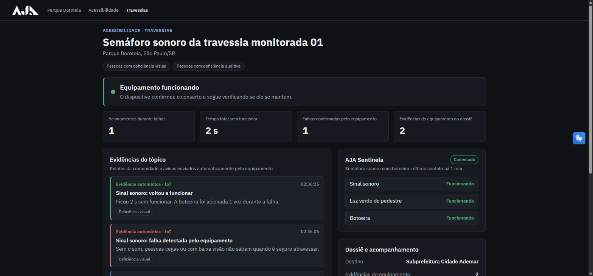
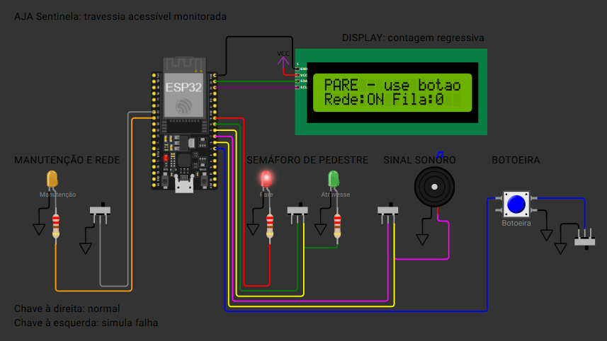

# AJA Sentinela · Physical Computing (IoT & IoB)

**Equipe:** Guilherme Santos Nunes (RM558989) · Kaique Rodrigues Zaffarani (RM556677) · Pedro Josué Pereira Almeida (RM554913)


| Entrega | Link |
|---|---|
| Projeto no Wokwi | https://wokwi.com/projects/480729769213749249 |
| Tópico da travessia no AJA (ao vivo) | https://api-production-bd33c9e7.up.railway.app/topicos/travessia-01 |
| Vídeo de demonstração | `URL_DO_VIDEO` |

## O AJA

O **AJA** é uma plataforma de participação cidadã que transforma relatos da comunidade em demandas fundamentadas de melhoria da infraestrutura do bairro. O primeiro recorte é a **acessibilidade para pessoas com deficiência visual e auditiva no Parque Doroteia**, em São Paulo.

Moradores relatam uma barreira, o relato vira um **tópico**, a comunidade apoia e confirma, e o AJA reúne relatos, evidências e dados públicos num **dossiê** para o órgão responsável. Depois, acompanha o protocolo até a resposta. Quando a intervenção acontece, uma seção de **conquistas** verifica, com evidências de antes e depois, se a mudança atendeu a quem precisava e se continua funcionando.

## O problema que o circuito resolve

Um semáforo sonoro quebrado é uma barreira invisível. Quem enxerga não percebe que o bip parou; a pessoa cega só descobre na esquina. Uma lâmpada verde queimada é o mesmo problema para a pessoa surda, que depende do sinal visual. Hoje, quem convive com a falha precisa relatar sozinho e provar que ela existe, e ninguém confirma se o conserto se manteve.

## Como o hardware se liga ao AJA

O **AJA Sentinela** é um ESP32 instalado dentro do equipamento de travessia. Ele é cadastrado no AJA e ligado ao tópico daquela travessia, e passa a ser uma **fonte automática de evidência** do tópico, ao lado dos relatos dos moradores.

```
 Semáforo sonoro + botoeira                     Plataforma AJA
 ┌──────────────────────────┐                   ┌───────────────────────────────────────┐
 │ ESP32 · AJA Sentinela    │   HTTPS + JSON    │ API de dispositivos                   │
 │ opera a travessia        │ ────────────────▶ │  confere o dispositivo e a chave      │
 │ verifica som, luz e      │  fila offline:    │  anexa o evento ao tópico             │
 │ botoeira                 │  nada se perde    │ Tópico da travessia                   │
 │ conta acionamentos (IoB) │                   │  evidências · impacto · dossiê        │
 └──────────────────────────┘                   └───────────────────────────────────────┘
```



O que cada aviso faz no tópico:

| Aviso do dispositivo | No AJA |
|---|---|
| `FALHA_DETECTADA` | Vira evidência no tópico, a situação passa a **barreira ativa** e o aviso entra no dossiê para a Subprefeitura Cidade Ademar. |
| `FALHA_RESOLVIDA` | Registra quanto tempo o equipamento ficou parado e **quantas vezes a botoeira foi acionada durante a falha**: pessoas que precisaram do recurso e não tiveram. |
| `RELATORIO_PERIODICO` | Mostra o uso da travessia e a disponibilidade de cada parte. Depois de um conserto, é o que confirma que a melhoria **continua funcionando**. |
| `DISPOSITIVO_INICIADO` | Marca o início do monitoramento. |

### Onde entra o IoB (Internet of Behaviors)

O dispositivo não identifica ninguém: só **conta** acionamentos e travessias. Esse comportamento de uso, agregado e anônimo, vira argumento no dossiê ("a botoeira foi acionada 4 vezes enquanto o sinal sonoro estava mudo") e evidência de resultado depois da intervenção.

## O circuito




| Componente | GPIO | Papel |
|---|---|---|
| Botoeira (botão azul) | 4 | Pedido de travessia, lido por interrupção (tecla **B** no Wokwi) |
| LED vermelho | 19 | Pare e vermelho piscante (finalize a travessia) |
| LED verde | 18 | Atravesse |
| Retorno da luz verde | 5 | Lê a tensão que chega ao LED verde |
| Buzzer | 17 | Bip de localização e bips de travessia |
| Retorno do som | 16 | Lê o sinal que chega ao buzzer |
| LED âmbar | 33 | Pisca quando há falha (equipe de manutenção) |
| Display LCD 16x2 I2C | 23 (SDA), 22 (SCL) | Contagem regressiva, essencial para a pessoa surda |
| Chave de rede | 32 | Simula a internet fora do ar |

**Como a falha é detectada:** o pino de retorno fica depois do fio que vai ao componente. Com o circuito íntegro, ele lê o mesmo sinal enviado; com o fio rompido, o pull-down leva a leitura a LOW. A falha (e o conserto) só é confirmada depois de **3 verificações seguidas**, para evitar alarme falso. Com a luz verde apagada, um pulso de 200 µs, invisível, faz o teste.

**Sem internet:** a rede roda numa tarefa separada do FreeRTOS, então o semáforo nunca espera a conexão. Os avisos ficam numa fila e só saem dela depois que a API confirma o recebimento.

### Chaves de simulação de falha

Alavanca **à direita = normal**, **à esquerda = simula a falha**. O projeto abre com todas no normal.

| Chave | Grupo | Simula |
|---|---|---|
| ao lado do buzzer | Sinal sonoro | fio do alto-falante rompido |
| entre os LEDs | Semáforo de pedestre | lâmpada verde queimada |
| ao lado do botão | Botoeira | botoeira travada |
| ao lado do LED âmbar | Manutenção e rede | queda de internet |

## A API do AJA (`api/`)

| Método | Rota | Função |
|---|---|---|
| `POST` | `/api/v1/dispositivos/eventos` | Recebe um aviso do dispositivo (cabeçalhos `X-AJA-Device-Id` e `X-AJA-Device-Key`) |
| `GET` | `/api/v1/topicos/travessia-01` | Estado do tópico: situação, evidências, impacto e dossiê |
| `GET` | `/topicos/travessia-01` | Tela do tópico, atualizada a cada 2 s |
| `GET` | `/docs` | Documentação automática (Swagger) |

Exemplo de aviso enviado pelo ESP32:

```json
{
  "dispositivo_id": "AJA-PDOR-TRAV-001",
  "tipo": "FALHA_RESOLVIDA",
  "seq": 14,
  "uptime_s": 412,
  "ts": "2026-11-19T10:41:07-03:00",
  "componente": "SINAL_SONORO",
  "publico_afetado": ["deficiencia_visual"],
  "tempo_inoperante_s": 95,
  "acionamentos_durante_falha": 4
}
```

A localização e o tópico ficam no cadastro do dispositivo na plataforma, não no aviso. Avisos repetidos (mesmo dispositivo, tipo, `seq` e `uptime_s`) são ignorados, porque o ESP32 reenvia quando não recebe confirmação.

## Como executar

**Circuito:** abra o link do Wokwi e clique em ▶. Os avisos aparecem na tela do tópico em poucos segundos. Para usar outro servidor, troque `AJA_API_URL` no início do `firmware/sketch.ino`.

**API, localmente:**

```bash
cd api
pip install -r requirements.txt
uvicorn main:app --reload
# abra http://127.0.0.1:8000/topicos/travessia-01
```

Variáveis: `AJA_DEVICE_KEY` (chave do dispositivo), `AJA_ADMIN_KEY` (reinício da demonstração) e `AJA_DB` (caminho do banco SQLite). Na nuvem, o `Dockerfile` da raiz publica a API no Railway com o banco num volume persistente.

## Segurança e privacidade

- Nenhum dado pessoal: o dispositivo envia só códigos, contagens e tempos.
- Cada dispositivo se identifica por um ID e uma chave, comparada em tempo constante. Como o projeto do Wokwi é público, a chave de demonstração fica visível no código; em produção, ela ficaria gravada na memória do ESP32 e seria revogável na plataforma.
- A tela do tópico insere textos apenas como texto (sem HTML vindo da API) e limita o tamanho dos avisos.
- **HTTP no Wokwi, HTTPS em campo:** no simulador, o TLS feito em software deixa o ESP32 lento a ponto de derrubar o Wi-Fi simulado. Por isso o firmware envia por HTTP a um proxy TCP do Railway (`junction.proxy.rlwy.net:30564`), que entrega à mesma API. A tela do tópico continua em HTTPS. O firmware já suporta HTTPS: em campo, basta usar a URL `https://` e fixar o certificado da API.

## Acessibilidade da tela do tópico

Contraste de pelo menos 4,5:1 em todos os textos, fonte grande, navegação por teclado com atalho para o conteúdo, anúncio de novas evidências para leitores de tela (`aria-live`) e tradução para Libras pelo **VLibras**.

## Limitações

- No Wokwi, as falhas são simuladas por chaves. Em campo, o retorno viria de sensores de corrente no circuito do alto-falante e da lâmpada.
- O dispositivo detecta falha elétrica. Um alto-falante que recebe sinal mas não emite som exigiria um microfone apontado para ele.
- Os relatos de moradores na tela do tópico são simulados; os avisos do equipamento são reais, enviados pelo ESP32 no Wokwi.

## ODS

- **ODS 11 · meta 11.7:** espaços públicos seguros, inclusivos e acessíveis, em especial para pessoas com deficiência.
- **ODS 10 · meta 10.2:** inclusão social independentemente de deficiência.
- **ODS 9 · meta 9.1:** infraestrutura de qualidade, confiável e resiliente, com monitoramento contínuo.

## Referências

- ABNT NBR 9050: Acessibilidade a edificações, mobiliário, espaços e equipamentos urbanos.
- Conselho Nacional de Trânsito (CONTRAN). Manual Brasileiro de Sinalização de Trânsito, Volume V: Sinalização Semafórica.
- ONU. Objetivos de Desenvolvimento Sustentável 9, 10 e 11.
- Espressif. Documentação do ESP32 Arduino Core.
- Wokwi. Documentação do simulador.
